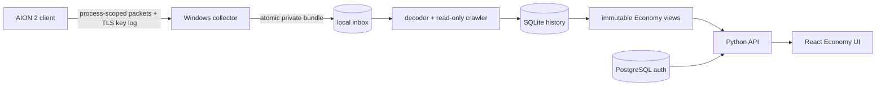

# AION2 Market Stack

[](https://github.com/dimkk/aion2-market-stack/actions/workflows/ci.yml)
[](LICENSE)
[](deploy/self-hosted/README.md)

A local-first research stack for observing an AION 2 client session, decoding
the confirmed read-only market flow, collecting prices, and serving a searchable
Economy UI. The listener runs on Windows; the worker, PostgreSQL, API, and React
frontend run with Docker Compose.

> [!CAUTION]
> **Use at your own risk.** This software was created for interoperability and
> research on sessions controlled by the operator. It is not affiliated with,
> endorsed by, or authorized by NCSOFT. You are responsible for local law,
> account agreements, network policy, and any account or data loss.

> [!WARNING]
> **The current public assembly has not been end-to-end release-tested.** Expect
> rough edges and finish or adapt it yourself. The core market parsing path has
> worked in the authors' research workflow across dozens of parsing runs,
> including passes over all 100 configured Global market scopes. That evidence
> does not guarantee this checkout, your client build, Docker host, or future
> protocol versions.

The longer bilingual wording and data/licensing boundaries are in
[DISCLAIMER.md](DISCLAIMER.md).

## What is included



- standalone Windows/Npcap collector; no A2Tools runtime or source code;
- bounded analyzer and read-only market crawler;
- SQLite market history and immutable snapshot publication;
- PostgreSQL-backed authentication with `guest`, `registered`, `approved`, and
  `admin` roles;
- React Economy UI with items, server views, movers, crafting, farm sessions,
  and crawler status;
- a sanitized historical seed database and views, so the site contains data on
  first start;
- `.env.example`, safe loopback defaults, CI, tests, security policy, and
  contributor guidance.

Raw captures, TLS key logs, JWTs, cookies, account identifiers, and real `.env`
files are deliberately excluded.

## Quick start

Prerequisites: Windows 11, Python 3.12, Npcap, Docker Desktop with Compose v2,
and a normally installed AION 2 client. Install host drivers and Docker yourself;
this repository does not silently change Windows, WSL, or network settings.

```powershell
git clone https://github.com/dimkk/aion2-market-stack.git
cd aion2-market-stack

python -B scripts\validate_self_hosted.py
.\deploy\self-hosted\scripts\Initialize-Env.ps1
.\deploy\self-hosted\scripts\Start-Stack.ps1
```

Open <http://127.0.0.1:8080>. The bundled snapshot is historical research data;
it is replaced only after your own collector supplies a valid current session
and the read-only crawler completes.

To capture your own session, run this in an elevated foreground PowerShell:

```powershell
.\deploy\self-hosted\scripts\Start-Collector.ps1
```

If Steam was not started with `SSLKEYLOGFILE`, the explicit operator helper can
launch it once:

```powershell
.\deploy\self-hosted\scripts\Start-Aion2WithCapture.ps1
```

Then create the first local administrator without placing a password in command
history:

```powershell
.\deploy\self-hosted\scripts\Bootstrap-Admin.ps1 -Username admin
.\deploy\self-hosted\scripts\Test-Stack.ps1
```

See the complete [self-hosted runbook](deploy/self-hosted/README.md).

## Seed data

`data/seed/` contains a sanitized SQLite database and immutable API views built
from a read-only Global summary observation on 2026-10-10:

- 100 configured market scopes;
- 29,587 item/server summary rows;
- no raw response bodies, headers, credentials, or account/session material.

This is sample research data, not a current-price promise and not a complete lot
history. Provenance and rebuild instructions live in
[data/seed/README.md](data/seed/README.md).

## Repository map

| Path | Purpose |
| --- | --- |
| `tools/public_collector/` | Windows process-scoped capture wrapper |
| `services/market-worker/` | Decoder, scanner, SQLite ingest, snapshot publisher |
| `services/economy-api/` | Authentication and read API |
| `apps/economy-web/` | React Economy frontend |
| `deploy/self-hosted/` | Compose, Dockerfiles, and operator scripts |
| `data/seed/` | Sanitized historical starter database/views |
| `tests/` | Contract and integration tests |

## Safety boundaries

The crawler only implements the confirmed read-only market summary operation.
It does not buy, sell, list, inject into the game, bypass anti-cheat, extract
memory, replay captured packets to the server, or automate gameplay. API and UI
bind to loopback by default. Put an authenticated reverse proxy in front before
any remote exposure.

## Status

Source validation, API tests, web tests, and deterministic seed generation are
automated in CI. A green CI run is not proof that a specific live client session,
Npcap installation, or protocol version works. Please report reproducible issues
without attaching credentials, key logs, or packet captures.

## License

Project-owned source code is licensed under [Apache-2.0](LICENSE). The bundled
sanitized market observations, item metadata, names, and other client-derived
data are **not** relicensed under Apache-2.0; see [DISCLAIMER.md](DISCLAIMER.md)
and [data/seed/README.md](data/seed/README.md).
