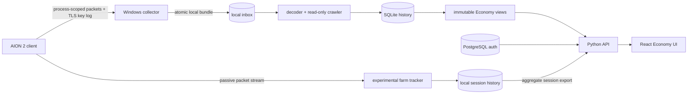

# AION2 Market Stack

<p align="center">
  
</p>

[](https://github.com/dimkk/aion2-market-stack/actions/workflows/ci.yml)
[](LICENSE)
[](deploy/self-hosted/README.md)

A local-first research stack for observing an AION 2 client session, decoding
the confirmed read-only market flow, collecting prices, and serving a searchable
Economy UI. The listener runs on Windows; the worker, PostgreSQL, API, and React
frontend run with Docker Compose.

> [!CAUTION]
> **Use at your own risk.** This software was created for interoperability and
> research on sessions controlled by the operator. It is not affiliated with,
> endorsed by, or authorized by NCSOFT. You are responsible for local law,
> account agreements, network policy, and any account or data loss.

> [!WARNING]
> **The current public assembly has not been end-to-end release-tested.** Expect
> rough edges and finish or adapt it yourself. The core market parsing path has
> worked in the authors' research workflow across dozens of parsing runs,
> including passes over all 100 configured Global market scopes. That evidence
> does not guarantee this checkout, your client build, Docker host, or future
> protocol versions.

The longer bilingual wording and data/licensing boundaries are in
[DISCLAIMER.md](DISCLAIMER.md).

## What's included



### 1. Protocol research & data collection

- TLS traffic capture and marketplace protocol decoding through the
  project-owned Windows/Npcap collector and bounded analyzer.
- A read-only market data collector covering multiple servers. It implements
  the confirmed market summary flow; it does not perform market actions.
- Historical price storage in SQLite, immutable snapshot publication, and a
  Python API for the derived data.
- A representative scan with **29,587 item/server records across 100 market
  scopes**. The bundled historical database contains that scan plus additional
  observations; its complete current counts are documented under
  [Seed data](#seed-data).

### 2. Economy Web UI (prototype)

- A searchable item database with market prices and price history.
- Price trends, market activity, movers, and server comparisons.
- A crafting calculator for material costs, buy-versus-craft decisions, and
  potential profit and ROI. Results are shown only when the required verified
  recipe, price, and tax inputs are available.
- Farming analytics for loot value, direct Kinah income, and farming efficiency
  from imported aggregate sessions.
- PostgreSQL-backed authentication with `guest`, `registered`, `approved`, and
  `admin` roles.

### 3. Experimental Farming Tracker

- A standalone passive proof of concept based on the same packet-analysis
  approach used by DPS meters.
- Decoding of the confirmed loot and Kinah event shapes to estimate farming
  income; unknown or malformed packet shapes are rejected.
- Session tracking, durable local history, and aggregate export compatible with
  the API import flow.
- Client-side capture integration is still experimental.

The repository also includes `.env.example`, safe loopback defaults, CI, tests,
a security policy, contributor guidance, and the complete safe derived market
history available at publication time so the UI contains data on first start.

Raw captures, TLS key logs, JWTs, cookies, account identifiers, and real `.env`
files are deliberately excluded.

## Quick start

Prerequisites: Windows 11, Python 3.12, Npcap, Docker Desktop with Compose v2,
and a normally installed AION 2 client. Install host drivers and Docker yourself;
this repository does not silently change Windows, WSL, or network settings.

```powershell
git clone https://github.com/dimkk/aion2-market-stack.git
cd aion2-market-stack

python -B scripts\validate_self_hosted.py
.\deploy\self-hosted\scripts\Initialize-Env.ps1
.\deploy\self-hosted\scripts\Start-Stack.ps1
```

Open <http://127.0.0.1:8080>. The bundled snapshot is historical research data;
it is replaced only after your own collector supplies a valid current session
and the read-only crawler completes.

To capture your own session, run this in an elevated foreground PowerShell:

```powershell
.\deploy\self-hosted\scripts\Start-Collector.ps1
```

For the experimental farming tracker, keep that collector running and start the
standalone module in a second foreground PowerShell:

```powershell
.\deploy\self-hosted\scripts\Start-FarmTracker.ps1
```

Its strict packet contracts, local endpoints, and current limitations are
documented in [tools/farm_tracker/README.md](tools/farm_tracker/README.md).
Before starting it, explicitly enable the bounded packet bus and set the exact
current character's market server ID in `.env`; the tracker has no default or
cross-server price fallback.

If Steam was not started with `SSLKEYLOGFILE`, the explicit operator helper can
launch it once:

```powershell
.\deploy\self-hosted\scripts\Start-Aion2WithCapture.ps1
```

Then create the first local administrator without placing a password in command
history:

```powershell
.\deploy\self-hosted\scripts\Bootstrap-Admin.ps1 -Username admin
.\deploy\self-hosted\scripts\Test-Stack.ps1
```

See the complete [self-hosted runbook](deploy/self-hosted/README.md).

## Seed data

`data/seed/` contains the complete safe derived SQLite market database available
at publication time and immutable API views built from it:

- 1,102 summary runs and 314,803 price rows across 101 observed market scopes;
- all 23,799 individual listing observations retained by the research database;
- no raw response bodies, headers, credentials, account/session material, or
  seller identities.

This is historical research data, not a current-price promise. It contains every
safe derived row available at publication time, but cannot include listings that
were never observed between scans. Provenance and rebuild instructions live in
[data/seed/README.md](data/seed/README.md).

## Repository map

| Path | Purpose |
| --- | --- |
| `tools/public_collector/` | Windows process-scoped capture wrapper |
| `tools/farm_tracker/` | Experimental passive farming-session tracker and aggregate export |
| `services/market-worker/` | Decoder, scanner, SQLite ingest, snapshot publisher |
| `services/economy-api/` | Authentication and read API |
| `apps/economy-web/` | React Economy frontend |
| `deploy/self-hosted/` | Compose, Dockerfiles, and operator scripts |
| `data/seed/` | Historical derived market database/views |
| `tests/` | Contract and integration tests |

## Safety boundaries

The crawler only implements the confirmed read-only market summary operation.
It does not buy, sell, list, inject into the game, bypass anti-cheat, extract
memory, replay captured packets to the server, or automate gameplay. API and UI
bind to loopback by default. Put an authenticated reverse proxy in front before
any remote exposure.

## Status

This is a working but rough **Proof of Concept**, not a finished product or a
hosted service. Some parts are incomplete, client integration remains
experimental, and bugs are expected.

The research, code, and prototypes are shared as-is. Feel free to fork, fix, or
build on top of them. There are no roadmap or support promises -- just an
engineering rabbit hole that got a little out of control. :)

Source validation, API tests, web tests, and deterministic seed generation are
automated in CI. A green CI run is not proof that a specific live client session,
Npcap installation, or protocol version works. Please report reproducible issues
without attaching credentials, key logs, or packet captures.

## License

Project-owned source code is licensed under [Apache-2.0](LICENSE). The bundled
derived market observations, item metadata, names, and other client-derived
data are **not** relicensed under Apache-2.0; see [DISCLAIMER.md](DISCLAIMER.md)
and [data/seed/README.md](data/seed/README.md).
