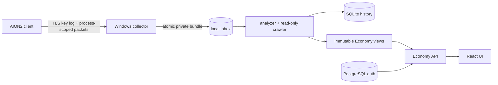

# Self-hosted Economy stack

This is the public, local-first distribution of AION2 Protocol Lab. It keeps
capture and session material on the Windows host and runs only the analyzer,
read-only market crawler, PostgreSQL, Economy API and web UI in Docker.

The host collector is a small standalone project-owned Npcap wrapper. It may run
alongside other overlays, but they are not part of this stack.

The first start seeds SQLite and immutable views from `data/seed/`, so the UI is
immediately populated with a historical sanitized example. A successful live
scan publishes a new revision without resetting that history.

## Architecture



The collector never prints the TLS key log or raw packet bytes. The worker
extracts the current market request template in memory, calls only the pinned
read-only summary endpoint and deletes the consumed bundle. Nothing here buys,
sells, lists or changes game state.

## Prerequisites

- Windows 11 with Python 3.12 and Npcap already installed;
- Docker Desktop with Compose v2, installed by the operator;
- a normally installed AION2 client and a session the operator is allowed to use;
- generated build-scoped files under `exports/economy/`.

Docker Desktop/WSL/Npcap installation changes the host and is intentionally not
automated by this repository.

## Quick start

From the repository root in PowerShell:

```powershell
.\deploy\self-hosted\scripts\Initialize-Env.ps1
.\deploy\self-hosted\scripts\Start-Stack.ps1
```

If Steam was not started with `SSLKEYLOGFILE`, close it once and use the explicit
operator action below. It launches Steam/AION2 visibly and is never called by
Docker or by the collector:

```powershell
.\deploy\self-hosted\scripts\Start-Aion2WithCapture.ps1
```

In an elevated foreground PowerShell, start the host collector:

```powershell
.\deploy\self-hosted\scripts\Start-Collector.ps1
```

Then bootstrap the first administrator without putting a password on the command
line and verify the stack:

```powershell
.\deploy\self-hosted\scripts\Bootstrap-Admin.ps1 -Username admin
.\deploy\self-hosted\scripts\Test-Stack.ps1
```

Open `http://127.0.0.1:8080`. The API is loopback-bound by default. Put an
authenticated reverse proxy in front of it before any remote exposure.

Stop containers while retaining PostgreSQL data:

```powershell
.\deploy\self-hosted\scripts\Stop-Stack.ps1
```

`-RemoveDatabase` is deliberately explicit and destructive for the local Docker
volume; do not use it for an ordinary restart.

## Client-derived assets

`item-catalog.json`, `recipes.json` and the icon manifest are build-scoped
generated data. PNG files stay out of Git. `Start-Stack.ps1` runs
`Prepare-Assets.ps1`, which validates local PNGs when they are present and stages
them into ignored runtime storage. Without local PNGs, the UI uses its built-in
fallback; a hash mismatch still stops staging.

## Configuration

`.env.example` documents all supported settings. `Initialize-Env.ps1` creates an
ignored `.env` with random database and session secrets and never prints them.
The market JWT/session is not an `.env` setting: it is recovered from the current
local client session, kept in worker memory and discarded after a scan.

## Verification

The source package can be checked without Docker:

```powershell
python -B scripts\validate_self_hosted.py
$env:PYTHONPATH = (Resolve-Path 'services/economy-api').Path
python -B -m pytest -q
```

Add `--require-assets` only when you have supplied the optional client-derived
PNG directory and want its content hashes validated as part of the check.

Docker build and runtime acceptance remain distinct checks. A green source
validator does not claim that Docker, Npcap or a live game session exists.
